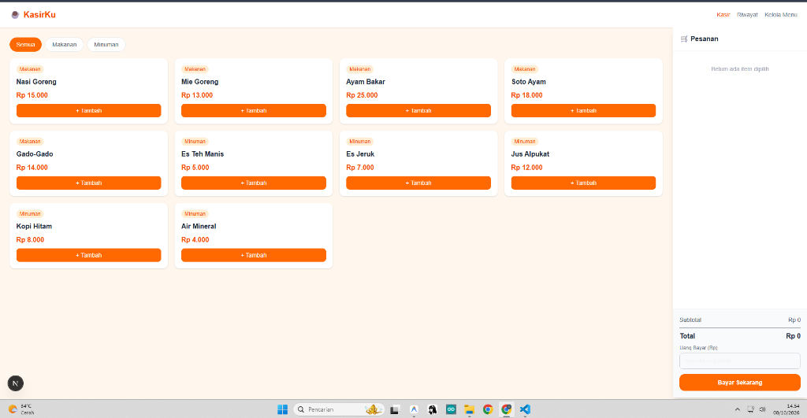
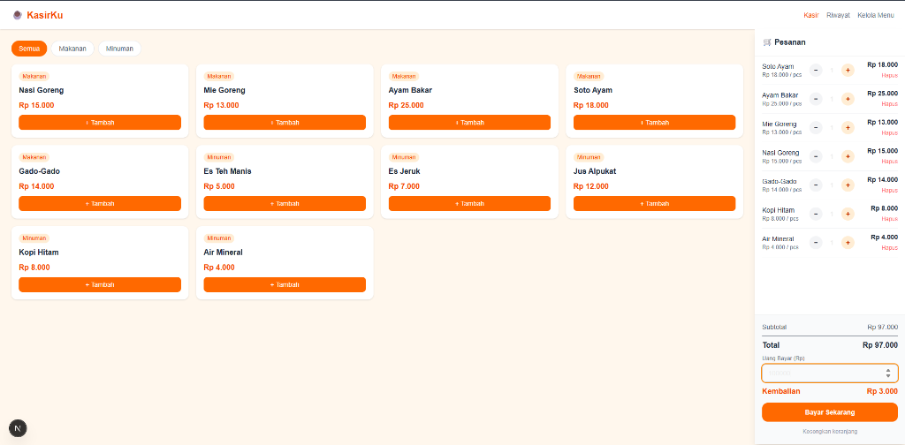
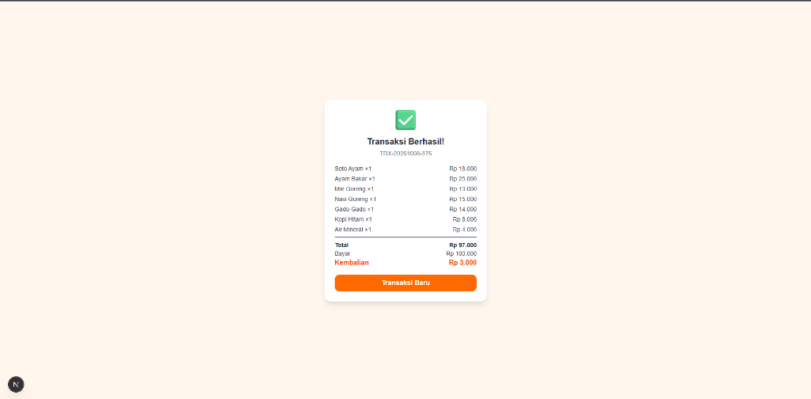
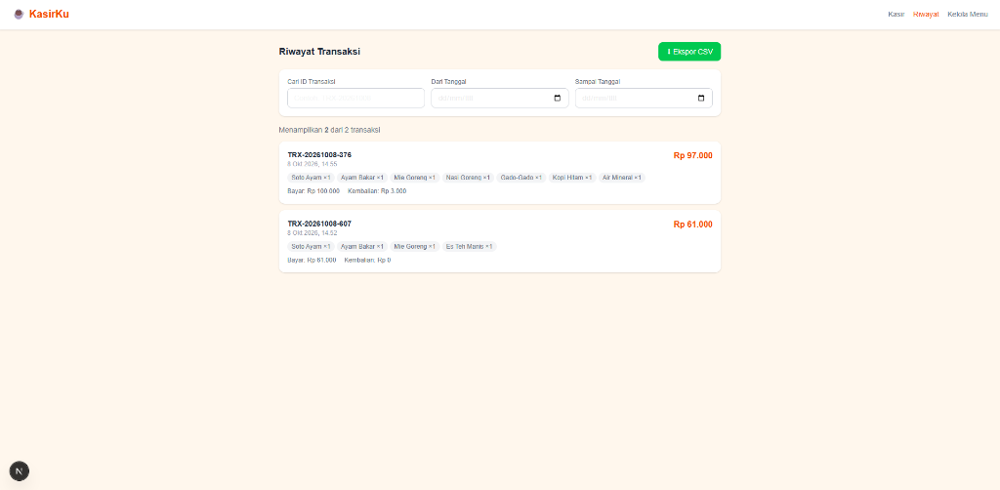
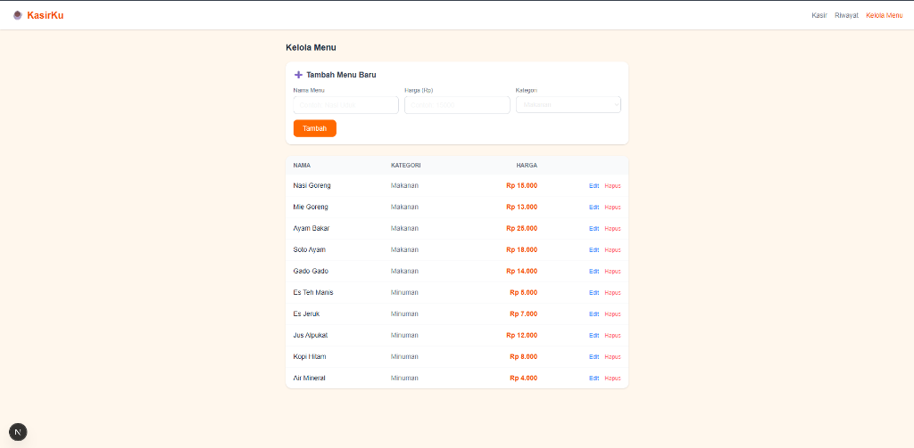

# Kasir Mini Market — Aplikasi Kasir Minimarket

Aplikasi kasir berbasis web untuk minimarket dan toko kelontong. Kasir dapat memilih produk barang, menghitung total tagihan dan kembalian secara otomatis, serta melihat riwayat transaksi.

## Alur Inti

1. Kasir membuka halaman utama dan melihat daftar produk barang minimarket
2. Kasir memilih produk dan mengatur jumlah barang yang dibeli
3. Sistem menghitung total belanja, menerapkan diskon otomatis jika total >= Rp 100.000
4. Kasir memasukkan nominal uang bayar, sistem menghitung kembalian secara otomatis
5. Kasir menekan tombol "Bayar Sekarang" dan transaksi tersimpan
6. Kasir dapat melihat riwayat transaksi, mencari nomor transaksi, memfilter rentang tanggal, dan ekspor data ke CSV

## Cara Menjalankan (How to Run)

### Prasyarat

- Node.js versi 18 atau lebih baru
- npm versi 9 atau lebih baru
- Browser Chrome atau Firefox

### Langkah

1. Clone repositori:
   ```
   git clone https://github.com/fadlan139/kasir-cafe.git
   ```
2. Masuk ke folder proyek:
   ```
   cd kasir-cafe
   ```
3. Install dependensi:
   ```
   npm install
   ```
4. Jalankan website:
   ```
   npm run dev
   ```
5. Buka alamat berikut di browser: http://localhost:3000

### Jika terjadi masalah

- Port sudah dipakai: ganti port dengan `npm run dev -- -p 3001` lalu buka http://localhost:3001
- Error saat install: pastikan menggunakan Node.js versi 18+, cek dengan `node --version`

## Cara Menjalankan Pengujian

```
npx jest --no-coverage
```

Hasil yang diharapkan: 20 tests passed, 0 failed.

## Tangkapan Layar Alur Inti

1. Halaman Kasir (Daftar Produk): 
2. Keranjang & Perhitungan Tagihan: 
3. Modal Struk Transaksi Berhasil: 
4. Riwayat Transaksi & Fitur Filter/CSV: 
5. Halaman Kelola Barang: 

## Fitur

- Daftar produk dengan filter kategori (Sembako, Makanan, Minuman, Kebersihan)
- Keranjang belanja: tambah, kurangi, dan hapus item
- Perhitungan total tagihan belanja otomatis
- Diskon 10% otomatis jika total belanja >= Rp 100.000
- Hitung uang kembalian otomatis
- Validasi input (uang bayar kurang, keranjang belanja kosong)
- Riwayat transaksi tersimpan di peramban (localStorage)
- Pencarian transaksi berdasarkan ID transaksi
- Filter transaksi berdasarkan rentang tanggal
- Ekspor data transaksi ke file format CSV
- Kelola produk barang: tambah, ubah, dan hapus barang

## Batasan yang Diketahui

- Data tersimpan di localStorage (hilang jika browser dibersihkan)
- Belum ada sistem login/autentikasi
- Belum mendukung printer struk fisik
- Hanya berjalan di satu perangkat (tidak sinkron antar perangkat)

## Aturan Bisnis

| Aturan | Detail |
|---|---|
| **Diskon** | 10% otomatis jika total belanja ≥ Rp 100.000 |
| **Kembalian** | = Uang bayar − Total setelah diskon |
| **Validasi bayar** | Sistem menolak jika uang bayar < total tagihan |
| **Minimal item** | Harus ada minimal 1 item di keranjang untuk checkout |

## Struktur Folder

| File / folder | Isi |
|---|---|
| `docs/` | Dokumen proses kerja (spesifikasi, rencana, log prompt, kasus uji, dll.) |
| `src/app/` | Halaman Next.js (kasir, riwayat, kelola menu) |
| `src/components/` | Komponen UI (KartuMenu, ItemKeranjang) |
| `src/lib/` | Logika bisnis (kasir.js) dan storage helper (storage.js) |
| `src/__tests__/` | Unit test |
| `bughunt-kasir/` | Hasil Bug Hunt |

## Sumber dan Lisensi

| Nama | Sumber | Lisensi |
|---|---|---|
| Next.js | https://nextjs.org | MIT |
| Tailwind CSS | https://tailwindcss.com | MIT |
| React | https://react.dev | MIT |

## Tim

| Nama | Peran |
|---|---|
| E-DALANG | Pengembang Aplikasi (Full-Stack) |
"# kasir_cafe" 
